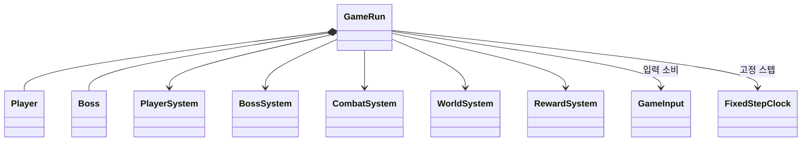

# 코드 구조와 OOP 브리핑

## 올림푸스 보스 확장 구조

`/01` 아에르기아와 `/02` 모모스는 기존 `Boss` 엔티티와 `GameRun` 전투 시스템을 사용하면서, 보스 행동을 아래 조합으로 확장한다.

```text
BossEncounter
├─ AergiaEncounter
│  ├─ entrance: AergiaEntrance extends BossEntrance
│  ├─ attacks:  AergiaAttacks  extends BossAttackSet
│  └─ mechanic: AergiaSlumber extends OncePerFightMechanic
└─ MomosEncounter
   ├─ entrance: MomosEntrance extends BossEntrance
   ├─ attacks:  MomosAttacks  extends BossAttackSet
   └─ mechanic: MomosCards   extends OncePerFightMechanic
```

- [`src/boss-encounter.mts`](src/boss-encounter.mts): 구성 요소의 계약, 기믹 1회 발동, 행동 실행 순서. 기믹 진행 중에는 일반 패턴을 중단한다.
- [`src/aergia.mts`](src/aergia.mts): 아에르기아의 정의·시작 상태·일반 패턴·수면 기믹·등장 타이밍. `AERGIA_RULES`에서 체력·반피 발동 조건·파편 수·기절 시간·수집 제한 16초·휘두르기 범위 330·분노 속도 1.3배를 조정한다. 파편 내려찍기는 피해 없이 기절만 주고, 수집 실패는 전멸 분기로 간다.
- [`src/momos.mts`](src/momos.mts): 모모스의 8계열 일반 패턴·2문제 카드 기믹·영구 후방 약점. `MOMOS_RULES`가 수치, `momosRearTarget()`이 약점 원의 단일 출처다. 폭발 자전거와 2연속 돌진은 별도 계열이며, 바퀴의 예정 착지도 일반 hazard로 전환/사망 시 함께 정리한다.
- [`src/momos-shapes.mts`](src/momos-shapes.mts): 클로버/하트의 실제 폐곡선, 다이아 격자, 안전 경계까지 필요한 이동 시간. 그림·판정은 같은 정점을 쓰며 같은 회차 다이아의 피해 여부는 `hitGroup`으로 공유한다.
- [`src/olympus-types.mts`](src/olympus-types.mts): `number`로 구분하는 `AergiaState | MomosState`. 런별 가변 상태만 보관한다.
- 공통 확장점: `BossMechanic.strikeTargets()`로 실제 공격을 바닥 카드에 전달. `BossEncounter.hitTarget()/canHit()`은 명중 위치/방향, `blocksMovement()`는 공중 몸통의 길막 여부를 결정한다. 기본 구현은 기존 보스 동작을 유지한다.
- [`src/olympus-encounters.mts`](src/olympus-encounters.mts): 구현된 보스 등록. [`src/olympus.mts`](src/olympus.mts): 등록된 보스의 `createState()`를 호출해 테스트 런과 프리셋을 만든다.
- [`src/olympus-render.mjs`](src/olympus-render.mjs): 선택한 보스의 그림만 로드, 공통 카메라·검 잔상·사슬·파편. [`src/momos-render.mjs`](src/momos-render.mjs)는 모모스 자세·카드·후방 표식·단검·튀는 바퀴·스페이드 창·등장씬을 그린다. 렌더는 게임 상태와 난수를 변경하지 않는다. 마우스 좌표는 줌과 화면 여백을 역변환한다.
- [`src/momos-art.mjs`](src/momos-art.mjs): 현행 imagegen v2 보스/초상 파일, 표시 키, 16자세의 실제 행 경계. 원화의 행 간격이 완전히 균등하지 않으므로 이미지 교체 시 경계를 확인해야 한다. 보존된 v1 SVG 제작 스크립트는 v2를 재생성하지 않는다.
- [`src/olympus-main.mjs`](src/olympus-main.mjs): 개별 라우트·로딩·입력·정지·HUD·음원. [`public/olympus.html`](public/olympus.html) / [`public/olympus.css`](public/olympus.css)가 화면 구성이다.

상속은 보스 정체성과 행동 계약에 사용하고, 일반 패턴·기믹·등장은 서로 포함 관계로 구성했다. 일반 패턴을 등장 연출의 부모 클래스로 만들지 않으므로 다음 보스에서 한 요소만 바꾸거나 공통 행동을 재사용하기 쉽다. 구성 요소 인스턴스는 행동만 제공하고 가변 상태는 `GameRun.olympus`에 있으므로 재도전이 이전 기믹 상태를 물려받지 않는다.

다음 보스는 먼저 사용자의 메모에 맞는 컴포넌트와 런 상태를 구현하고 등록한다. 그 후 `olympus-catalog.mts`의 해당 `ready`를 켠다. 아직 구현하지 않은 `/03`~`/50`은 준비 중 화면이며 기존 보스 행동을 대신 연결하지 않는다.

## 코드는 어디에 있나

**수정할 원본은 `src/`다.** 기존 `public/src/game.mjs`에 모여 있던 전투 코드를 TypeScript 모델과 시스템으로 분리했다. `public/src/`는 `npm run build`가 만드는 브라우저용 출력이라 직접 수정하지 않는다.

- `.mts`: ESM TypeScript 원본. 빌드하면 같은 이름의 `.mjs`가 된다.
- `.mjs`: 화면·그림·오디오 등 기존 JavaScript 원본. 같은 빌드가 `public/src/`로 복사한다.
- `public/index.html`, `public/styles.css`, `public/assets/`: HTML·스타일·그림·음원.
- `scripts/`: 로컬 서버·랭킹 서버·브라우저 QA.
- `tests/`: 기존 전투·콘텐츠·렌더·서버 회귀 테스트와 새 OOP 계약 테스트.

## 읽는 순서

1. [`src/types.mts`](src/types.mts): `RunState`, `InputState`, `Weapon`, `Pattern`, `Hazard`, `Attack` 등 데이터 형태.
2. [`src/entities.mts`](src/entities.mts): 플레이어와 보스가 보관하는 필드, 생성자, 플레이어 초기화 메서드.
3. [`src/game.mts`](src/game.mts): `GameRun` 생성자와 `step()`. 한 프레임에 무엇을 어떤 순서로 실행하는지 확인.
4. [`src/systems/player.mts`](src/systems/player.mts): 입력 → 이동·회피·충전 → 공격 생성.
5. [`src/systems/combat.mts`](src/systems/combat.mts): 생성된 공격과 투사체가 실제 피해를 주는 과정.
6. [`src/systems/boss.mts`](src/systems/boss.mts): 보스 이동, 패턴 선택, 예고·발동·후딜, 페이즈 전환.
7. [`src/systems/rewards.mts`](src/systems/rewards.mts): 카드 제안, 미리보기, 선택 후 다음 스테이지.
8. [`src/main.mjs`](src/main.mjs): 화면·키보드·마우스가 위 객체들을 사용하는 부분.

## 객체 관계



`GameRun`은 한 판의 상태를 소유한다. `Player`와 `Boss`는 전투 중 변하는 상태를 보관한다. 시스템은 런을 받아 자신이 맡은 처리만 수행하며, 별도의 런 상태를 보관하지 않는다. 따라서 시스템 객체는 공유해도 다른 런의 HP나 카드가 섞이지 않는다.

직업마다 `Warrior`, 무기마다 `Sword`, 합성마다 별도 하위 클래스를 만드는 대신 **데이터와 조합**을 사용했다. 직업·무기·패턴 정의는 `content.mts`, 공격 변형은 `builds.mts`의 프로필이다. 직업이나 카드 수치 변경은 이 정의에서 하고, 이동·명중·보상 규칙 변경은 해당 시스템에서 한다.

## 클래스·필드·메서드

| 클래스 / 파일 | 주요 필드 | 주요 메서드 / 책임 |
|---|---|---|
| `GameRun` / `game.mts` | `status`, `stage`, `stageCount`, `time`, `stageTime`, `cls`, `weapon`, `player`, `boss`, `cards`, `offers`, `attacks`, `projectiles`, `hazards`, `particles`, `events`, `feedback` | `constructor(options)`: 한 판 생성. `step(input, dt)`: 전투 진행. `getStats()`: 각인 적용 능력치. `getStorm()`: 자기장 상태. `chooseCard(id)`: 보상 확정. `previewReward(id)`: 미리보기. `cancelActions()`: 정지·종료 시 행동 취소. |
| `Player` / `entities.mts` | `x/y`, `hp/maxHp`, `faceX/faceY`, `attackCooldown`, `swing`, `charge`, `ammo`, `reloadTime`, `dodgeTime/dodgeCooldown`, `guardTime/counterCooldown`, `shield`, `comboStep`, `heat` | `constructor(cls, weapon)`: 직업 HP와 기본 탄창 설정. `cancelActions()`: 공격·충전·반격 자세 취소, 이미 지불한 쿨타임 유지. `resetForStage(magazine)`: HP를 유지하며 위치·전투 타이머·탄창 초기화. |
| `Boss` / `entities.mts` | `def`, `x/y`, `hp/maxHp`, `state`, `timer`, `pattern`, `phase`, `sequence`, `combo`, `raid`, `chargePaths` | `constructor(def)`: 보스 정의로 새 전투 상태 생성. 단계가 바뀌면 새 `Boss`를 만든다. 행동은 `BossSystem`이 담당. |
| `GameInput` / `input.mts` | `up/down/left/right`, `aimX/aimY`, `attack`, `attackPressed`, `dodge`, `counter` | `clear()`: 방향·행동 입력 해제. 조준 좌표는 유지. 단발 입력은 `PlayerSystem`이 소비. |
| `FixedStepClock` / `clock.mts` | `last`: 마지막 실시간(ms), `acc`: 누적 시간(초) | `advance(nowMs)`: 실행할 고정 스텝 수 계산(최대 5). `reset()`: 정지·복귀 시 누적 시간 제거, 복귀 첫 프레임은 0스텝. |
| `PlayerSystem` / `systems/player.mts` | 런 상태를 별도로 보관하지 않음 | `update(state, input, dt)`: 이동·회피·Q 반격 자세·충전·재장전·기본 연계·공격 생성. `cancel(state)`: 행동과 대기 공격 취소. |
| `BossSystem` / `systems/boss.mts` | 런 상태를 별도로 보관하지 않음 | `update(state, dt)`: 추적·패턴 상태 머신 진행. `advancePhase(state)`: HP 임계값 확인, 페이즈 변경과 이전 공격 정리. |
| `CombatSystem` / `systems/combat.mts` | 런 상태를 별도로 보관하지 않음 | `update(state, dt)`: 투사체 → 플레이어 공격 순서로 처리. 내부 `updateProjectiles()` / `updatePlayerAttacks()`: 이동·수명·명중·폭발·잔상 처리. |
| `WorldSystem` / `systems/world.mts` | 런 상태를 별도로 보관하지 않음 | `update(state, dt)`: 장판 → 자기장 → 입자 처리. `storm(state)`: 현재 자기장 계산. 내부 `updateHazards()` / `updateStorm()` / `updateParticles()`. |
| `RewardSystem` / `systems/rewards.mts` | 런 상태를 별도로 보관하지 않음 | `offers(state)`: 보상 3장과 유니크 보장 규칙. `preview(state, id)`: 원본 런과 분리된 미리보기. `choose(state, id)`: 자격 확인·카드 적용·회복·다음 보스 생성. |

필드 이름은 기존 렌더러·QA와의 호환을 위해 유지했다. 위치는 전장 좌표이고 전투 시간·쿨타임은 초다. `stage`는 코드에서 0부터 시작하지만 화면/콘텐츠 문서에서는 1부터 센다.

## `GameRun.step()`의 흐름

1. `playing` 상태인지 확인하고 페이즈·시간·피드백·보호막·원소 상태를 갱신한다.
2. 특수 보스의 별도 목표 기믹을 갱신한다.
3. `PlayerSystem`: 입력을 소비하고 플레이어를 이동시키거나 공격을 생성한다.
4. `CombatSystem`: 투사체와 플레이어 공격의 명중을 처리한다.
5. `BossSystem`: 페이즈가 바뀌지 않았고 별도 목표 진행 중이 아니면 보스 행동을 진행한다.
6. `WorldSystem`: 활성 위험 영역, 자기장 피해, 입자 수명을 처리한다.
7. 페이즈를 재확인하고 사망·처치·보상·최종 승리를 처리한다. 동시 사망/처치는 사망 우선.

이 순서와 기존 수치·판정·난수 소비 순서는 보존했다. 전투·보상·장식 난수는 `combatRng`, `rng`, `cosmeticRng`로 분리되어 있다.

## 클래스가 아닌 공통 함수와 데이터

| 파일 | 역할 |
|---|---|
| `systems/stats.mts` | `getStats()`: 기본 직업·무기 + 일반 각인 + 유니크/합성 → 실제 전투 능력치. |
| `systems/geometry.mts` | 원·부채꼴·직선·고리 충돌 판정과 예고 진행률. 렌더와 전투가 같은 기하를 사용. |
| `systems/effects.mts` | 위험 영역·입자 생성 상한, 피해 숫자, 타격 장식. |
| `content.mts` | 직업·기본 무기·일반 보스 패턴·캠페인·카드 카탈로그. |
| `builds.mts` | 직업 유니크 25종, 합성 50쌍, `deriveBuild()`와 `buildWeapon()`. |
| `signatures.mts` | 보스별 큰 패턴 20개와 각 라운드의 위험 도형 생성. |
| `encounters.mts` | 5·10·15·20단계의 엄폐·봉인·문양·반사 목표. |
| `boss-attacks.mts` / `attack-rhythm.mts` | 추가 보스 패턴 / 무기별 기본 공격 연계. |
| `stages.mts` | 전장 이름·테마·음악·타격 재질. |
| `random.mts` / `tutorial.mts` | 시드 난수 / 연습 진행 단계 계산. |

`src/game.mts`는 기존 `createRun()`, `step()`, `chooseCard()` 같은 함수 API도 다시 내보낸다. 기존 테스트·렌더러가 그대로 동작하도록 마련한 호환 API이며 구현은 클래스/담당 모듈 하나에 있다. 새 호출부는 객체 메서드를 사용하면 된다.

```ts
import { GameRun, GameInput, FixedStepClock } from './game.mjs';

const run = new GameRun({ classId: 'warrior', weaponId: 'sword', seed: 42 });
const input = new GameInput();
const clock = new FixedStepClock();
input.aimX = run.boss.x;
input.aimY = run.boss.y;
input.attack = true;
run.step(input); // 기본 1/60초. 화면에서는 clock.advance()의 결과만큼 실행한다.
const stats = run.getStats();
```

## 어디를 수정하면 되나

- **직업 HP·회피·기본 무기 수치**: `content.mts` → `CLASSES`.
- **유니크 효과·합성 조합**: `builds.mts` → `UNIQUES`, `FUSIONS`. 새 프로필 동작은 `PlayerSystem`/`CombatSystem`에 구현.
- **보스 일반 패턴**: `content.mts` / `boss-attacks.mts`. 패턴 선택·이동·예고는 `BossSystem`.
- **큰 패턴**: `signatures.mts` → `SIGNATURES`, `signatureRound()`.
- **특수 목표**: `encounters.mts`.
- **피해·반격·잔상 판정**: `CombatSystem`, `WorldSystem`, `geometry.mts`.
- **보상 확률·유니크 제한·다음 단계 초기화**: `RewardSystem`.
- **새 무기의 그림·음원·입력 안내**: `art.mjs`, `audio.mjs`, `main.mjs`, 필요하면 HTML/CSS.

## 빌드와 검증

```sh
npm install
npm run typecheck
npm run build
npm start
npm test
```

브라우저 실행 파일은 `public/src/boot.mjs`다. `npm start`는 빌드 후 기존 Node 서버를 시작한다. 이미 서버가 켜져 있다면 `npm run build` 후 새로고침하면 새 코드가 반영된다. 진행 중인 런은 새로고침 때 초기화된다.

TypeScript는 게임 모델·전투 시스템·기믹·콘텐츠에 적용했다. 화면·Canvas 원화/렌더링·오디오·시작 로더·랭킹 클라이언트와 Node 서버/기존 테스트는 JavaScript를 유지한다. 런타임 외부 패키지는 없고 TypeScript 컴파일러만 개발 의존성으로 추가했다.

타입 검사에는 `strict`, `noImplicitAny`, `noUnusedLocals`, 오류 시 출력 방지를 적용했다. 기존 공격 패킷의 선택 필드·null 상태 호환 때문에 **`strictNullChecks`는 아직 false**다. JavaScript 모듈은 복사 대상으로 포함하고 `checkJs`는 false다. 전체 코드의 엄격한 null 검사까지 완료한 상태는 아니다.

기존 전체 테스트 외에 `tests/oop.test.mjs`에서 클래스 생성, 객체/함수 API 결과 일치, 미리보기 격리·메서드 유지, 단계 전환, 입력·시계 초기화를 검사한다. `node --test`만 실행하면 브라우저 실행기까지 자동 발견하므로 `npm test` 또는 `node --test tests/*.test.mjs`를 사용한다.


## 요청받은 Git 초기 연동

요청된 대상은 `https://github.com/rlatlswo135/louge-like-test.git`, 브랜치는 `main`, 첫 커밋 메시지는 `init`이다. 현재 환경에서는 `.git` 생성과 GitHub 네트워크 접근이 차단되어 실제 연동·커밋·푸시는 수행하지 못했다. 프로젝트의 Git 쓰기와 네트워크가 허용된 터미널에서 아래 순서로 이어서 실행한다. 원격에 기존 커밋이 있으면 마지막 push가 거절될 수 있으므로 강제 push하지 않고 원격 내용을 확인한다.

```sh
git init -b main
git remote add origin https://github.com/rlatlswo135/louge-like-test.git
git add .
git commit -m init
git push -u origin main
```

`.gitignore`는 빌드 결과(`public/src/`), 설치 패키지, 기존 작업 로그(`.pi/`), 공유 랭킹 데이터(`data/`)를 제외한다. 처음 내려받은 뒤에는 `npm install`과 `npm run build`가 필요하다.
